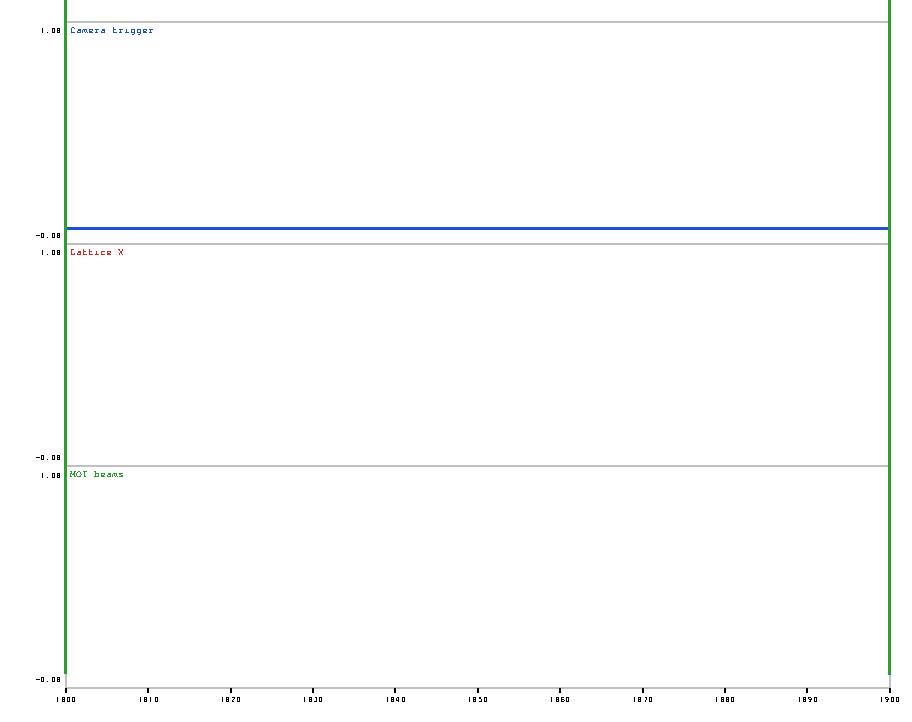
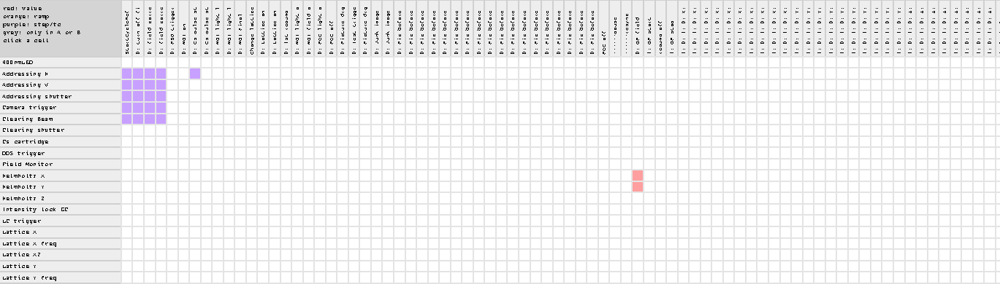
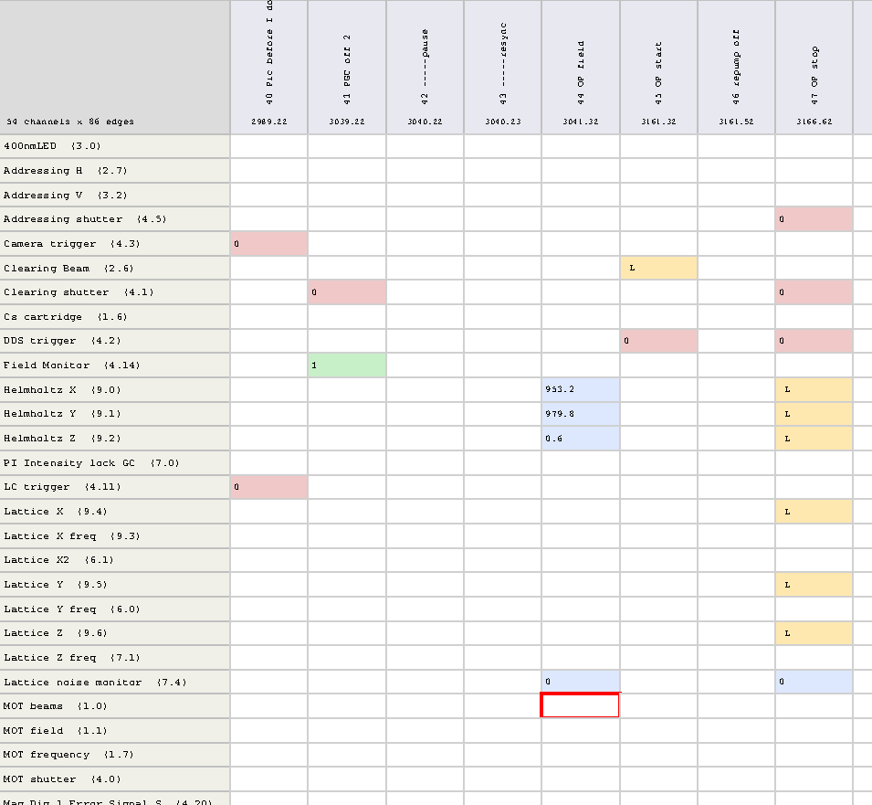

# Supertime Analysis

Tools and reverse-engineering notes for **Supertime**, the LabVIEW 6.1 experiment-control
program on the lab's Windows XP control PC. Started 2026-10-27 from a copy of the control
PC's disk (kept separately, not in this repository).

## What is here

| Path | Contents |
|---|---|
| `supertime_tools/FORMAT_NOTES.md` | Everything worked out about the file formats: `.dt4` sequence files, the `supertime*.log` run logs, the LabVIEW 6.1 front-panel/block-diagram heaps, and the partially decoded data-space defaults. |
| `supertime_tools/lvflat.py` | LabVIEW type-descriptor parser and unflattener. Decodes `.dt4`/`.dt3` sequence files using the descriptor embedded in a run-log header. |
| `supertime_tools/dt4dump.py` | Readable dump of a sequence file: variables, edges (absolute times, parents), channels with per-edge values and ramp functions. |
| `supertime_tools/logscan.py` | Walks a run log: lists every run (date, time, sequence file, cycle length) and can recover any run's sequence as a `.dt4`. |
| `supertime_tools/checkall.py` | Decodes every sequence file under a folder and reports failures. |
| `supertime_tools/lvheap6.py`, `lvdiagram6.py` | Raw walker and netlist reconstructor for LabVIEW 6.1 block diagrams (run on a VI extracted with pylabview `readRSRC -x`). |
| `supertime_tools/vi_calltree.py` | SubVI call tree and text labels for a folder of VIs. |
| `supertime_tools/lvdstm.py` | Exploration tool for the data-space type map and default-data block (constant values, unfinished). |
| `supertime_tools/lv61_strings.json` | String tables from LabVIEW 6.1's `labview.rsc`; the `CURS` table maps primitive ids to names. |
| `vi_diagrams/` | One text netlist per VI (209), `MAIN_*.txt` is the main program. |
| `docs/CUSTOM_RAMP_1009_NOTE.md` | Why the 26 Oct custom-ramp build turns every ramp into a step: the ramp-path table saved empty, loaded at run time behind a gate, and a per-channel loop whose count follows it. |
| `docs/CUSTOM_RAMP_BRIEF.md` | Briefing for another agent: the cooling spin-echo edges and timing, how the custom-ramp Supertime build maps a CSV shape onto a ramp, the ramp-number rule (channel row x position among the channel's enabled ramps), and what a drift correction across the hold implies. |
| `docs/SUPERTIME_ISSUES.md` | What makes Supertime slow and run out of memory on long sequences (ramp expansion by edge insertion), other per-run costs, silenced errors and hacks, and what would fix them. |
| `vi_printouts/` | The 2009 front-panel printout rendered from PostScript. |
| `supertime_tools/subvi_calltree.txt`, `subvi_text_labels.txt`, `main_vi_text_labels.txt` | Call graph and all panel/diagram text, including diagram comments. |

## Sequences (`sequences/`)

The control PC's `Admin\My Documents\2024`, `2025` and `2026` sequence folders, tracked here so edits
have a history. The first commit (37762bc) is the PC's state as copied on 2026-10-27; later commits are
edits made with the editor (2026: simplified edge names, cleaned variables, cooling-block variables).
`sequences/2026` is the working copy to open in the editor; the untouched originals also sit outside
this repository in the "Supertime Computer" disk copy. Edited files go to the control PC through the
USB stick's `Supertime Computer updates\sequence updates\<date>` folder (README.txt there says how).

## Sequence editor (`supertime_editor/`)

A Tkinter desktop app that opens, edits, compares and saves `.dt4` sequences outside LabVIEW.
Python 2.7 (the XP control PC) and Python 3 (Mac), standard library only.

```bash
python3 -m supertime_editor.app "some sequence.dt4"     # Mac/Linux, or double-click supertime_editor.command
supertime_editor.bat "some sequence.dt4"                 # Windows XP (uses C:\Python27)
```

* Grid of channels (rows) by edges in time order (columns); cells show the analog or digital
  value and a ramp marker (L linear, E exponential, O optical, C cubic, K custom). Double-click
  a cell to edit value, ramp, step size and time constant; double-click a column header to
  edit the edge (name, parent, relative time, variable); the Edges and Variables tabs list
  everything and jump the grid to the selected edge.
* Add/delete edges, variables and channels; absolute times are recomputed exactly the way
  Supertime does (parent + relative or variable time, rounded to the clock resolution).
* **Compare with...** opens a second sequence and lists every difference: cell values,
  ramps and step sizes, edge times/parents/variables, missing edges or channels, variables,
  settings. Select rows and copy A->B or B->A, or unify everything in one go; save either side.
  Two 1,400-edge cooling sequences compare in 0.1 s and unify in under a second.
* Files whose channel arrays are shorter than the edge list (over half of the 2024-2026
  files) are read tolerantly; **File > Repair channel arrays** pads them.
* **Ramps:** Supertime enables a ramp only where the cell's time constant is nonzero; the
  ramp then runs from that edge's value to the next edge where the channel has a value, with
  the cell's ramp function and step size. Cells with a function set but a zero time constant
  are inert and drawn as a small grey letter ("grey disabled ramps" hides them).
* **Step sizes at a glance:** the "cells show" box switches the grid between value + ramp,
  value + ramp + step (`4.2` over `L 40u` = linear ramp, 40 us steps), step size only, or
  time constant.
* **Editing many cells at once:** click, Shift-click (range), Ctrl/Cmd-click (add) or click a
  row header (whole channel) to select cells, then Return or "Edit selected cells": blank
  fields keep each cell's own value. "Batch edit..." finds cells by channel, edge-name pattern,
  value, step size or ramp (preview selects them) and sets value/step/ramp/time constant on
  all of them, so a value repeated in every cooling block changes everywhere in one go.
  "Batch edit edges..." sets the relative time of every edge matching a name pattern.
* **Plot...** draws value against time for the selected channels (holds between edges;
  enabled ramps are drawn as the discrete staircase Supertime outputs, one level per step-size
  interval). Ramp shapes follow the formula nodes in `Functions and derivatives for fit.vi`
  with both end points fixed: Exponential `a0*exp(-x/t)+a2`, Optical `P0/(x/tau+1)^2+C`,
  Cubic `P0*(2.777u+5.440u^2+3.663u^3)+C`, Linear. Gaussian and Blackman are drawn as pulses
  (baseline = start value, peak = end value, width = the interval; amplitude convention not
  verified). Custom ramps (shape from a CSV) are drawn linear., one strip per channel or overlaid; drag to zoom, mouse
  readout. From the compare window, "Plot A vs B" overlays both sequences (B dashed).
* The **Ramp list** tab lists every enabled ramp with its step count, most steps first, and
  the total number of output steps, for finding what eats sequence memory; click one to jump
  to it. Below the list, and in the status bar, is the **sequence cost**: per-channel ramp
  steps (Supertime's compile time grows with the square of this), the number of distinct time
  points after ramp expansion with the size of the channel array Supertime builds, and a level:
  ok below 10,000 points, heavy (slow compile) above, at the memory limit from 20,000 (the 2026
  cooling sequences sit at 21,000-25,000). See `docs/SUPERTIME_ISSUES.md` for why.
* **Check ramps** (also run on open and before save): flags enabled ramps with no ramp
  function, steps below the 2 us clock, steps that are not whole microseconds, and simultaneous ramps on different channels
  whose step sizes have no common multiple of at least 2 us (e.g. 5 us against 2 us), which
  makes Supertime attempt 1 us edges and breaks the sequence. Problems are listed in the Ramps
  tab and the cells outlined in magenta. This catches the August 2025 bug in the Testbed and
  Pre-20250731 files.
* **Edit > Simplify edge names** drops the numeric prefixes that splicing adds (`0: `,
  `1: 18: 1: 0: `), keeping the shortest prefix that still makes every name unique; the
  compare window can match edges ignoring those prefixes.
* **Edit > Simplify variables** strips the splice prefixes from variable names (`0: `, `000`),
  merges variables with the same simplified name and value, repoints the edges that use them,
  and removes variables no edge uses; edge times are unchanged.
* Saving keeps the two orderings Supertime depends on: the Edge Array in time order and the
  Variable Array in name order (a file without them hangs Supertime's calculation).
* `python -m supertime_editor.audit file.dt4` lists likely mistakes: inconsistent arrays,
  parent cycles, duplicate pins, edges below the clock, conflicting same-instant values, ramp
  step conflicts, unterminated or disabled-but-intended ramps, values on the wrong channel
  type, unused variables.
* The compare window has a **graphical diff** above the list: matched channels x matched
  edges, red where a value differs, orange for ramp, purple for step/time constant, grey where
  an edge or channel exists on one side only; click a cell to see both sides and select its
  rows.




`supertime_editor/lvcore.py` is the canonical reader/writer (`record.td` carries the LabVIEW
type descriptor so no log file is needed); `model.py` the editable model; `diff.py` the
comparison and unify logic; `app.py` the GUI.



## Requirements

Python 3 (standard library only for the sequence tools). `pylabview` and ghostscript were
used to extract VIs and render the printouts.

## Typical use

```bash
python3 supertime_tools/dt4dump.py <supertime.log-or-its-1MB-head> <sequence.dt4>
python3 supertime_tools/logscan.py <supertime.log>
```
